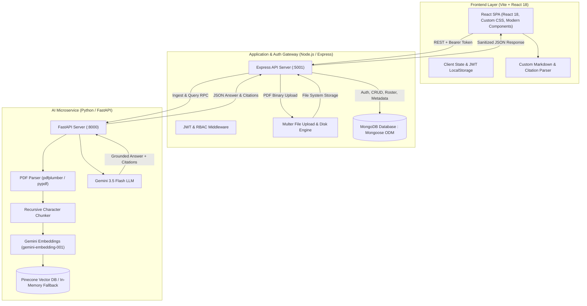
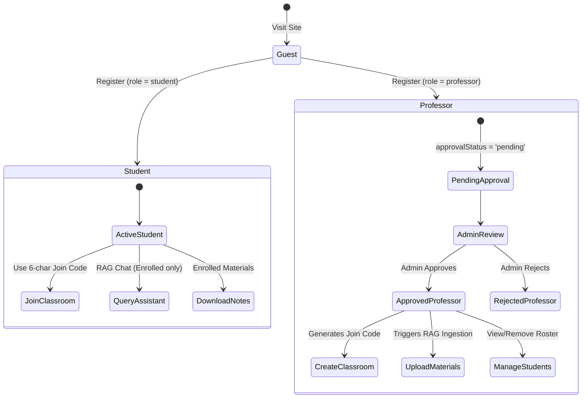
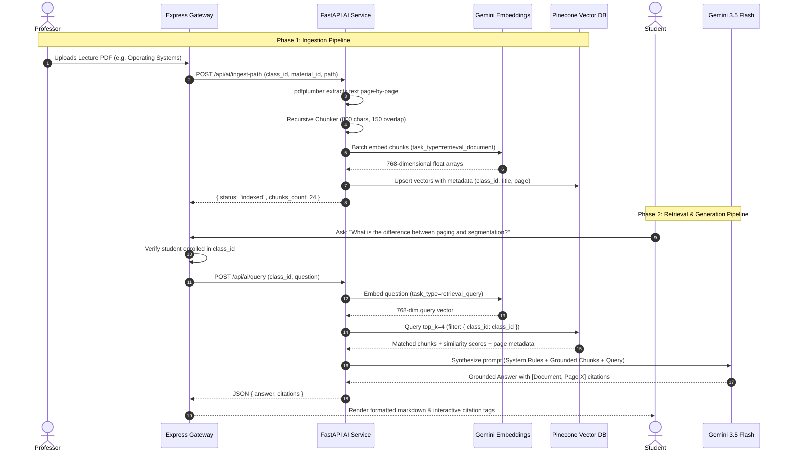

# Acad Nexus (CampusMind) — Master System Design, Implementation & RAG Interview Guide

This guide is an exhaustive technical reference for **Acad Nexus (CampusMind)**. It is structured specifically for technical interviews, system design defenses, and deep architectural study.

---

## 1. High-Level System Architecture

Acad Nexus is built as a **decoupled 3-tier microservices architecture** designed for high modularity, independent scalability, and specialized workload execution.



### Architectural Decisions: Why Decouple Express and FastAPI?

| Dimension | Monolithic Node.js | Monolithic Python (Django/FastAPI) | **Decoupled Express + FastAPI (Our Choice)** |
| :--- | :--- | :--- | :--- |
| **I/O & CRUD Efficiency** | Excellent async event loop for high-concurrency HTTP. | Good, but slower synchronous library ecosystem for CRUD. | **Express** handles high-throughput CRUD, JWT verification, and file I/O with minimal latency. |
| **Data Science / AI Ecosystem** | Weak (limited vector math, awkward Python wrappers). | Strong (Native `numpy`, `scipy`, `pypdf`, `torch`). | **FastAPI** handles linear algebra, PDF parsing, chunking algorithms, and vector embeddings natively. |
| **Scaling & Resource Allocation** | Heavy ML tasks block Node event loop unless spawned as child processes. | Heavy database loads and ML execution share memory space. | **Independent Scaling**: Express runs on lightweight CPU nodes; FastAPI can scale on compute/GPU-optimized nodes independently. |
| **Failure Isolation** | AI model timeout or PDF memory leak crashes the entire web app. | Database connection pool exhaustion crashes AI query endpoints. | **Resilience**: If FastAPI crashes or hits rate limits, students can still log in, view classes, and download materials without downtime. |

---

## 2. Core Concepts & End-to-End Workflows

### 2.1 Role-Based Access Control (RBAC) & Security

The platform enforces a strict 3-tier security model:



1. **Authentication Strategy**:
   - **Password Hashing**: `bcryptjs` with salt factor 10. Passwords are never stored in plain text.
   - **Stateless Tokens**: JSON Web Tokens (JWT) containing `id`, `role`, and `email` signed with a secure server secret (`JWT_SECRET`).
   - **Client Storage**: Stored in `localStorage` under `acadNexusToken`. Transmitted on every request in the HTTP header: `Authorization: Bearer <token>`.
2. **Authorization Middleware** (`authMiddleware.js`):
   - `authenticateUser`: Decodes JWT, validates signature and expiration, populates `req.user`.
   - `authorizeRoles("professor", "admin")`: Enforces endpoint-level role verification.
3. **The Professor Verification Gatekeeper**:
   - Untrusted users registering as professors receive `approvalStatus: "pending"`.
   - They cannot create classes or upload materials until an **Admin** explicitly approves their account in the Admin Dashboard. This prevents unauthorized users from injecting malicious PDFs into student vector stores.

---

### 2.2 Classroom Lifecycle & Isolation

1. **Join Code Mechanism**:
   - Each classroom gets an auto-generated unique, collision-resistant join code (e.g., `PHY301`).
   - Students enter the code to join; MongoDB adds their `_id` to the class's `students` array using `$addToSet` (preventing duplicate enrollments).
2. **Cross-Tenant Data Isolation**:
   - Class materials and vector chunks are tagged with `class_id`.
   - Before executing any operation (reading materials, downloading files, or querying the RAG model), the backend verifies that the requester is either the **professor who owns the class** or an **enrolled student** (`students.includes(req.user.id)`).

---

### 2.3 File Upload Pipeline

1. **Multer Storage Engine**:
   - Receives multipart form data (`multipart/form-data`).
   - Validates MIME type strictly for `application/pdf`.
   - Saves file to `./uploads/materials/` with an alphanumeric collision-resistant timestamp filename.
2. **Cascade Deletion**:
   - When a professor deletes a material:
     1. The file is unlinked from the server disk (`fs.unlinkSync`).
     2. The document is deleted from MongoDB (`Material.findByIdAndDelete`).
     3. An HTTP call is made to FastAPI (`DELETE /api/ai/materials/{id}`), which deletes all associated vector chunks from Pinecone.

---

## 3. The RAG (Retrieval-Augmented Generation) Deep-Dive

This is the most critical technical component of Acad Nexus.



---

### 3.1 Why RAG? (The Architectural Trade-Off Analysis)

In an interview, you must justify **why** RAG was chosen over alternative architectures:

| Approach | Description | Pros | Cons / Why We Rejected |
| :--- | :--- | :--- | :--- |
| **Fine-Tuning an LLM** | Retraining model weights on uploaded course slides and PDFs. | Custom tone and style. | **Rejected**: <br>1. High compute cost (\$100s–\$1000s per fine-tune). <br>2. Takes hours/days per upload (not instant). <br>3. Prone to catastrophic forgetting and hallucinations. <br>4. Cannot cite specific page numbers reliably. <br>5. Updating or deleting a document requires retraining the entire model. |
| **Prompt Stuffing (Full Context Window)** | Feeding the entire 200-page PDF into Gemini 1.5/2.0's 1M+ context window on every prompt. | No chunking or vector database needed. | **Rejected**: <br>1. Latency: Processing 500k tokens per user message takes 8–15 seconds. <br>2. Extreme Cost: Token costs explode when 50 students ask 10 questions each. <br>3. "Needle in a Haystack" problem: LLMs suffer attention degradation when relevant information is buried in the middle of giant context windows. |
| **Traditional Keyword Search (BM25 / Elasticsearch)** | Inverted index searching for exact word matches. | Fast and cheap. | **Rejected**: <br>1. Misses semantic synonyms (e.g., student searches "deadlock prevention", but the slide uses "mutual exclusion avoidance"). <br>2. Cannot understand natural language intent. |
| **Retrieval-Augmented Generation (Our Choice)** | Convert documents into semantic vector embeddings, retrieve Top-K relevant chunks, and pass only those to the LLM. | **Chosen**: <br>1. **Real-time**: Chunks indexed in seconds. <br>2. **Low Latency & Low Cost**: LLM only processes ~2,000 tokens per query. <br>3. **Verifiable Citations**: Exact document and page citations. <br>4. **Zero Hallucination Guardrails**: Strict context boundary. <br>5. **Instant Deletion**: Simply purge vectors from Pinecone. |

---

### 3.2 Ingestion Engine: Parsing, Chunking & Math

#### A. Page-Preserving Extraction
We parse PDFs page-by-page using `pdfplumber` / `pypdf`. Preserving page numbers is crucial: without it, you cannot provide legal, academic, or textbook citations (e.g., `[OS_Lecture4.pdf, Page 14]`).

#### B. Recursive Character Text Splitting
Why not split by arbitrary character count (e.g., every 800 characters)?
If you split strictly at index 800, you will slice words in half (e.g., `"concur"` ... `"rency"`) and sever sentences.

Our custom `split_text_into_chunks` uses recursive hierarchy delimiters:
```python
separators = ["\n\n", "\n", ". ", "? ", "! ", " ", ""]
```
1. It first attempts to split on paragraph breaks (`\n\n`).
2. If a paragraph exceeds `chunk_size` (800 characters), it splits on sentence boundaries (`. `, `? `, `! `).
3. If a sentence exceeds `chunk_size`, it splits on words (` `).
4. If a word exceeds `chunk_size`, it splits characters as a last resort.

#### C. Chunk Size (800) and Overlap (150)
- **Why Chunk Size = 800 characters (~150-200 tokens)?**
  In educational material, an academic concept (e.g., definition of Dijkstra's algorithm, time complexity, and invariant) typically spans 1–2 paragraphs. 800 characters captures the complete concept without diluting vector density with unrelated topics.
- **Why Chunk Overlap = 150 characters?**
  If a theorem is stated at character 750 and its proof starts at character 820, a hard cut breaks the semantic connection. The 150-character overlap ensures that the end of Chunk $N$ and the start of Chunk $N+1$ share context, guaranteeing search queries find both.

---

### 3.3 Vector Embeddings & Asymmetric Search

#### A. Embedding Model: `models/gemini-embedding-001`
- **Output Dimensionality**: 768 dimensions.
- **Why 768 dimensions instead of 1536 or 3072?**
  768 dimensions offers the optimal balance for academic retrieval. It provides high semantic resolution while cutting vector storage memory and cosine calculation latency by 50% compared to 1536-dim models.

#### B. Asymmetric Retrieval Tasks (`retrieval_document` vs `retrieval_query`)
Most people make the mistake of using the same embedding logic for documents and queries. We use **Asymmetric Semantic Search**:
- **Ingestion**: `task_type="retrieval_document"`
  Tells the embedding model to optimize the vector for an informative, descriptive body of text.
- **Querying**: `task_type="retrieval_query"`
  Tells the embedding model that this short text is an inquiry seeking an answer. The model projects the question into the vector space near the corresponding *answers*, rather than near similar *questions*.

#### C. Cosine Similarity Vector Math
Cosine similarity measures the angle between two normalized vectors:

$$\text{Cosine Similarity}(Q, D) = \frac{Q \cdot D}{\|Q\| \|D\|} = \frac{\sum_{i=1}^{n} Q_i D_i}{\sqrt{\sum_{i=1}^{n} Q_i^2} \sqrt{\sum_{i=1}^{n} D_i^2}}$$

When vectors are $L_2$-normalized ($\|Q\| = 1$ and $\|D\| = 1$), the denominator becomes 1, and cosine similarity reduces to a lightning-fast dot product:

$$\text{Similarity} = \sum_{i=1}^{768} Q_i D_i$$

---

### 3.4 Vector Database: Pinecone & In-Memory Resiliency

1. **Pinecone Serverless (`aws: us-east-1`)**:
   - Manages index scaling automatically with zero server maintenance.
   - Vector records store:
     - `id`: Unique chunk ID (`{materialId}_p{page}_c{chunkIdx}`).
     - `values`: 768-dimensional float array.
     - `metadata`: `{"class_id": str, "material_id": str, "document_title": str, "page_number": int, "text": str}`.
2. **Metadata Filtering (Cross-Tenant Security)**:
   ```python
   index.query(
       vector=query_vector,
       top_k=4,
       filter={"class_id": class_id}, # HARD SECURITY FILTER
       include_metadata=True
   )
   ```
   This guarantees that even if another class has an identical textbook, a student can *only* search materials uploaded to their enrolled class.
3. **Resilience & Testing (`InMemoryVectorStore`)**:
   If Pinecone is unreachable or API keys are missing during CI/CD test runs, the system falls back to an in-memory vector store that computes cosine similarity using `numpy` arrays.

---

### 3.5 System Prompt Engineering & Strict Grounding

To eliminate hallucination and guarantee academic integrity, the LLM prompt is engineered with strict constraints:

```text
You are an academic AI teaching assistant for Acad Nexus.
Your job is to answer students' questions thoroughly, accurately, and strictly using ONLY the provided course documents.

Rules:
1. Ground your answer in the provided document context.
2. For every fact, concept, or section you explain, cite the source in the format: [Document Name, Page X] (where X is an integer page number like 2, not 2.0).
3. If the provided documents do not contain enough information to answer the question, state:
   "Based on the uploaded course materials for this class, this topic is not covered in the current documents."
4. Structure your response with clean, elegant academic formatting:
   - Use concise section titles (e.g., ### 1. Topic Name).
   - Use clean bullet points or numbered lists (• Label: Details...).
   - Format mathematical complexities cleanly in plain text or standard notation like O(log n), O(n).
   - Do not use horizontal separator lines (---).
```

### 3.6 Frontend Rendering & Interactive Citations

Standard React markdown libraries (like `react-markdown` with `rehype-raw`) introduce heavy bundles and XSS attack vectors. Acad Nexus uses a custom token parser [`ChatMessageContent.jsx`](file:///Users/ayushpratapsingh/campusmind/frontend/src/components/ChatMessageContent.jsx):
- Regex matches tokens: `(\*\*[^*]+\*\*|\$[^$]+\$|`[^`]+`|\[[^\]]+,\s*Page\s*[^\]]+\])`.
- Renders:
  - `[Syllabus.pdf, Page 3]` $\rightarrow$ Interactive citation pill badge (`.chat-inline-citation`).
  - `$O(n \log n)$` $\rightarrow$ Math code chip (`.chat-math-code`).
  - `**Heading**` $\rightarrow$ Bold emphasis (`.chat-bold-text`).

---

## 4. Full Technical Stack Summary

| Layer | Technologies Used | Key Responsibilities |
| :--- | :--- | :--- |
| **Frontend** | React 18, Vite, CSS Modules / Custom Design System | Responsive dashboards, live state updates, custom markdown & citation parser. |
| **API Gateway** | Node.js, Express.js | JWT verification, RBAC, REST API, Multer upload engine, error boundary middleware. |
| **Database** | MongoDB, Mongoose ODM | Relational-like document models (`User`, `Class`, `Material`, `Professor`). |
| **AI Microservice** | Python 3.11, FastAPI, Uvicorn | Async REST endpoints, PDF extraction, vector chunking, embedding generation. |
| **Vector DB** | Pinecone Serverless (AWS), NumPy (Fallback) | Top-K cosine similarity search with class-level metadata filtering. |
| **AI Models** | Google Gemini 3.5 Flash (`gemini-3.5-flash`), Gemini Embeddings (`gemini-embedding-001`) | Fast dense vector generation (768-dim) and grounded answer synthesis. |
| **Testing** | Node assert test runner, Pytest | Contract testing, chunker verification, vector store mocking, API health suites. |

---

## 5. Top 10 Technical Interview Questions & Answers

### Q1: "How do you prevent hallucinations in your RAG pipeline?"
> **Answer**: We employ a multi-layered guardrail:
> 1. **Prompt Constraint**: The system prompt strictly prohibits extrapolating beyond the provided context and instructs the model to reply with an explicit fallback message if the topic is not covered.
> 2. **Citation Requirement**: The model must tag assertions with `[Document Name, Page X]`.
> 3. **Top-K Distance Filtering**: Only chunks with high cosine similarity scores are passed to the context window.
> 4. **Low Temperature**: We use deterministic settings to minimize creative divergence.

### Q2: "What is chunk overlap, and why did you choose 150 characters?"
> **Answer**: Chunk overlap is the repeating sequence of text retained between adjacent chunks. Without overlap, concepts split at chunk boundaries lose context. 150 characters (~25–30 words) ensures that subject-verb predicates, equations, or definitions that span a split boundary are preserved in both chunks, preventing query retrieval misses.

### Q3: "How do you handle multi-tenancy and data privacy between classes?"
> **Answer**: Multi-tenancy is enforced at both the API layer and the vector database layer:
> 1. **Express Layer**: Before calling the AI service, Express verifies the user's JWT and checks that their ID exists in the class's enrolled `students` array or matches `professorId`.
> 2. **Pinecone Metadata Filter**: Every vector is stored with `metadata: { "class_id": "..." }`. The query specifies `filter={"class_id": classId}`, ensuring Pinecone's search index is strictly partitioned by class.

### Q4: "Why use Pinecone instead of PostgreSQL with pgvector?"
> **Answer**: Pinecone Serverless provides managed indexing (HNSW) without needing to configure vector memory parameters (`work_mem`, `hnsw.ef_search`). It automatically scales with zero maintenance. However, because our architecture isolates the vector store behind a unified interface (`VectorStoreService`), swapping Pinecone for `pgvector` or Milvus requires changing only one adapter file without touching the rest of the application.

### Q5: "What happens when a professor deletes a lecture PDF?"
> **Answer**: We execute a 3-step cascade deletion:
> 1. Delete physical file from disk via Node.js `fs.unlinkSync`.
> 2. Delete database metadata record from MongoDB (`Material.findByIdAndDelete`).
> 3. Dispatch an async `DELETE` request to FastAPI, which purges all vector chunks matching that `material_id` from Pinecone.

### Q6: "Why did you use Gemini 3.5 Flash rather than Gemini Pro or GPT-4o?"
> **Answer**: Speed and cost. In a classroom study assistant, conversational latency is the primary user experience metric. Flash offers sub-second Time-To-First-Token (TTFT) and is more than capable of summarizing and synthesizing factual context retrieved from textbook chunks at a fraction of the token cost.

### Q7: "How did you design for offline development or missing API keys?"
> **Answer**: We implemented an **in-memory vector store fallback** and a **deterministic mock embedding generator**. Using SHA-256 hashing of chunk text into a pseudo-random seed, we generate normalized 768-dimensional float arrays. This allows unit tests, CI/CD pipelines, and local UI development to run without live API keys or cloud vector DB connections.

### Q8: "How does the frontend render citations without raw markdown tags?"
> **Answer**: Instead of third-party markdown packages that can bloat bundle size or fail on custom tokens, we wrote a tokenizer [`ChatMessageContent.jsx`](file:///Users/ayushpratapsingh/campusmind/frontend/src/components/ChatMessageContent.jsx). It tokenizes bold text, inline code, math expressions, and citation syntax `[Doc, Page X]`, converting citations into styled pill badges and math formulas into readable monospace blocks.

### Q9: "How would you scale this system to 100,000 active students?"
> **Answer**:
> 1. **Asynchronous Ingestion Queue**: Replace synchronous HTTP calls during PDF upload with a message broker (RabbitMQ or Redis BullMQ). Ingestion workers process chunking and embedding in the background.
> 2. **Semantic Caching**: Store question embeddings and LLM answers in Redis. If two students in the same class ask similar questions (cosine similarity $> 0.95$), return the cached response instantly without invoking Gemini.
> 3. **MongoDB Read Replicas**: Distribute student dashboard and roster reads across read replicas while routing class updates to the primary.

### Q10: "What is the difference between Symmetric and Asymmetric search?"
> **Answer**: Symmetric search is when query and document have similar lengths and characteristics (e.g., finding articles similar to another article). Asymmetric search is when the query is short (e.g., "What is mutex?") while documents are long explanatory paragraphs. We configure `task_type="retrieval_query"` and `task_type="retrieval_document"` so the embedding model embeds short queries and long passages into a shared, compatible space.
